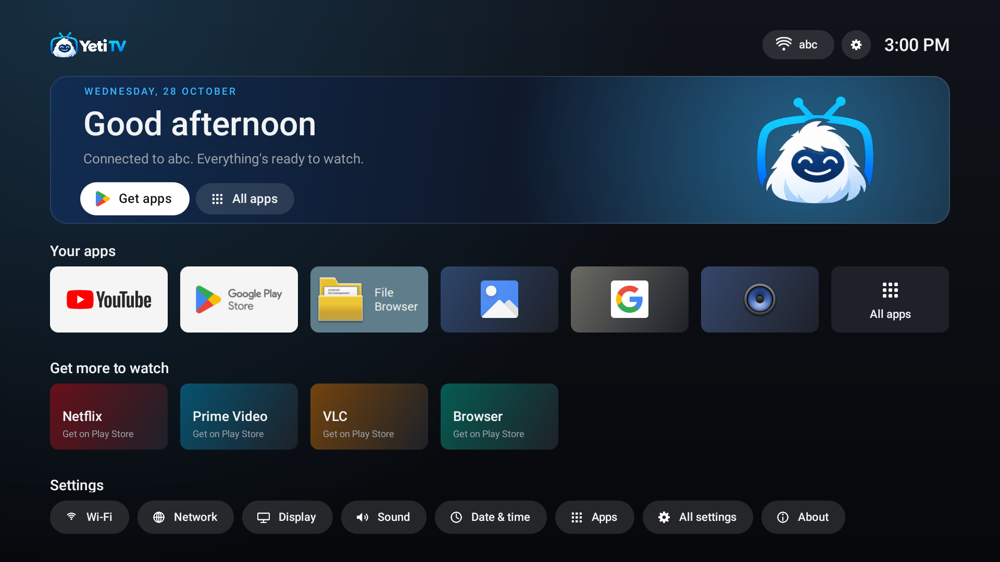
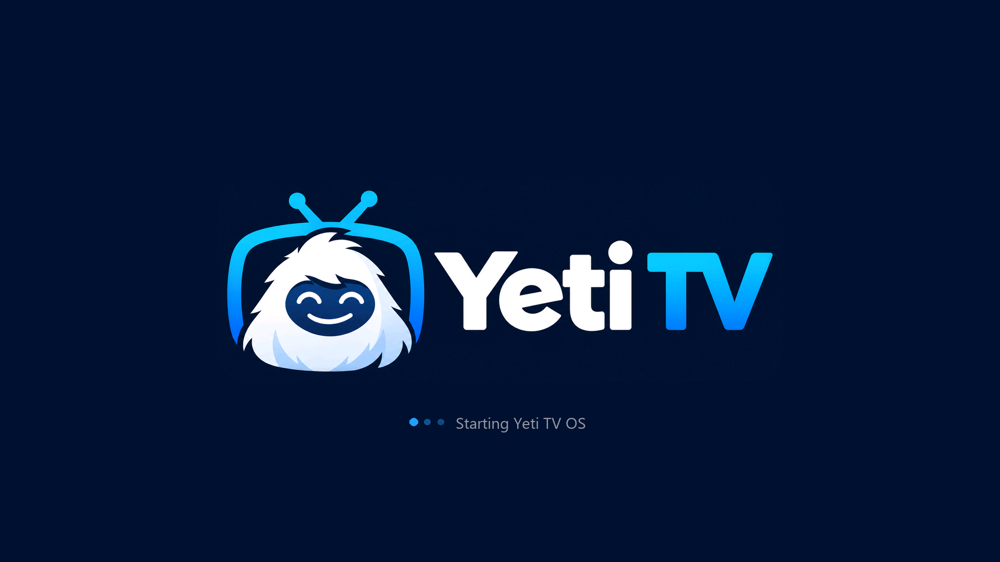
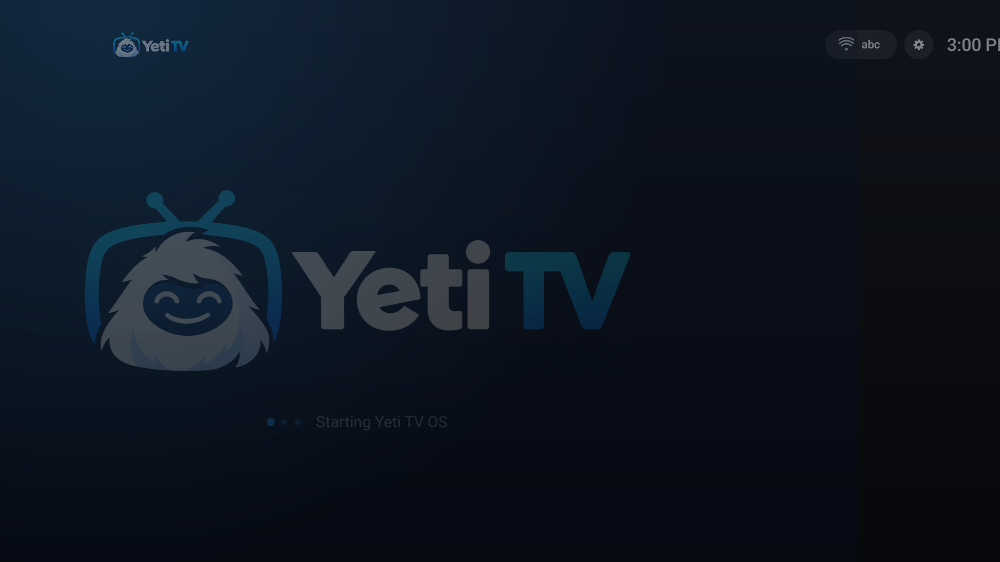
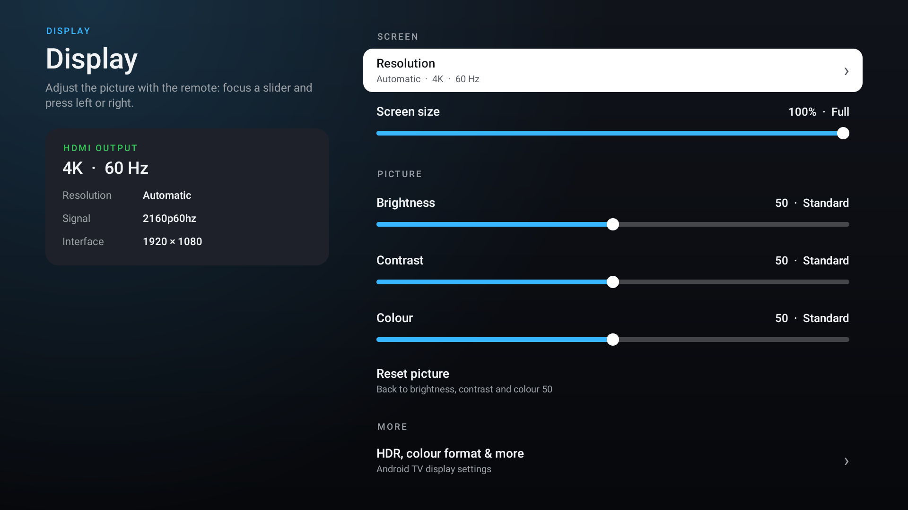
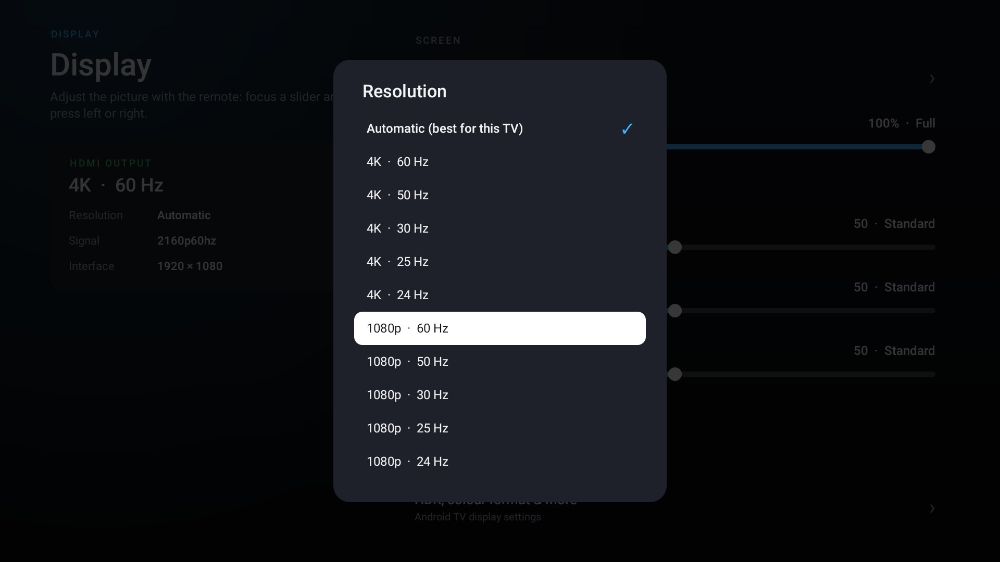
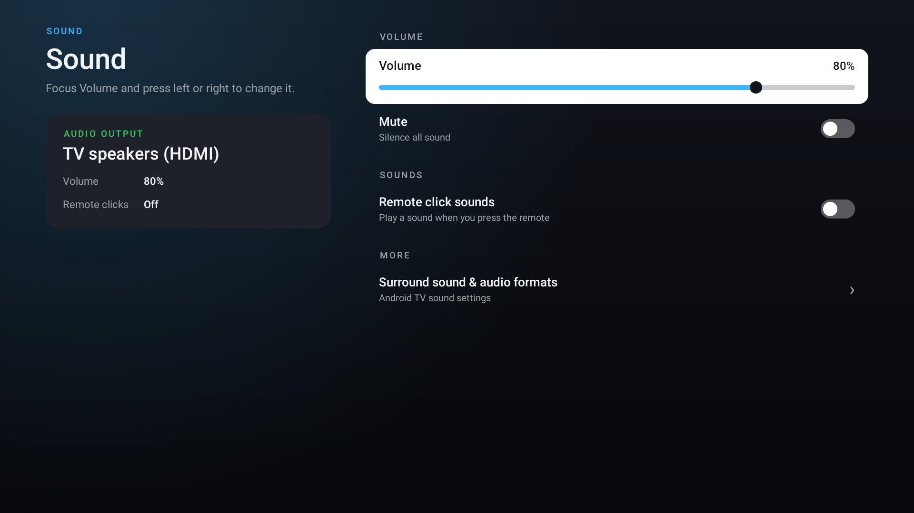
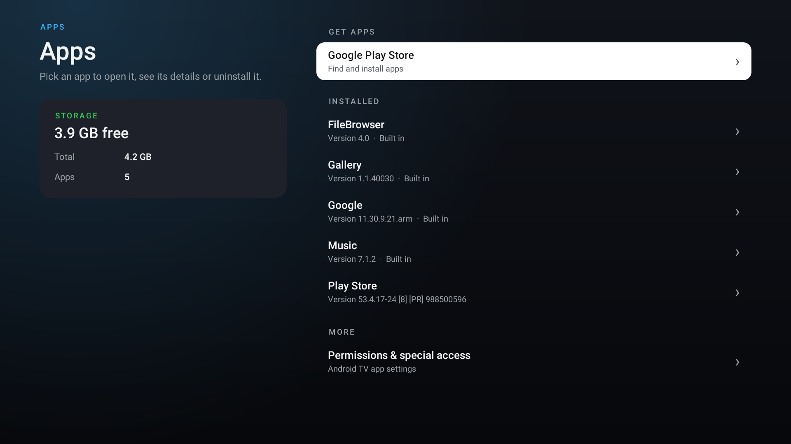

# Yeti TV OS

**Yeti TV OS** is the home screen and system experience of Yeti TV boxes — a clean, Google TV-style launcher for
Android TV hardware, with its own settings, Wi-Fi setup, picture controls and branded boot.

Created by **Udit Kumar Mahato — Founder, Yeti TV**.



## Features

- **Home** — Google TV-style layout: greeting and connection status, your apps as 16:9 cards (streaming apps first),
  one-click installs for popular streaming apps, and a quick settings row. Fully remote-friendly: white focus ring,
  zoom, and focus that always returns to the top on Home.
- **Branded boot** — the power-on logo, the boot animation and the first launcher frame are the same image, so the
  box goes from logo to home with no jumps and no black screen; the splash slides away and the home rows glide in.
- **Wi-Fi** — built-in network picker: scan, connect with password, signal and connection details, forget networks.
- **Display** — resolution (automatic or any mode the TV reports, with a 15-second "keep this resolution?" safety
  revert), screen size for TVs that crop the edges, and whole-picture brightness, contrast and colour.
- **Sound, Network, Date & time, Apps** — Yeti TV's own settings pages for the everyday options, each linking to the
  full Android TV settings for the rest.
- **About** — Yeti TV OS version and live device information.

| | |
|---|---|
|  |  |
|  |  |
|  |  |

## Hardware

Built and tested on an Amlogic **S905W2** box (Android 11 base, 4K HDMI output, 1080p UI). The layout is designed on
a 1920×1080 canvas and scaled to whatever resolution the box renders at. Display controls (resolution, screen size,
brightness) use the Amlogic `droidlogic` vendor library when it is present and hide themselves otherwise.

## Build

See the [developer guide](docs/DEVELOPER_GUIDE.md) for hardware notes, architecture and device setup.

Requirements: Android SDK (platform 34), JDK 17 (Android Studio's bundled JDK works).

```bash
./gradlew assembleRelease
```

Release builds are signed with the key described in `keystore.properties` (copy
`keystore.properties.example` and fill it in). Without it the build falls back to the debug key.

## Install on a box (Windows, USB or network adb)

```powershell
powershell -ExecutionPolicy Bypass -File tools\dev.ps1
```

`tools/dev.ps1` builds, installs, sets Yeti TV OS as the home app, grants the permissions the settings pages need
(Wi-Fi scan, system settings, display mode changes), AOT-compiles the launcher for a fast first frame after boot and
saves screenshots of every screen to `shots/`.

The permissions it grants, if you install by hand:

```bash
adb shell appops set tv.yeti.launcher WRITE_SETTINGS allow
adb shell pm grant tv.yeti.launcher android.permission.WRITE_SECURE_SETTINGS
adb shell pm grant tv.yeti.launcher android.permission.INTERACT_ACROSS_USERS
adb shell pm grant tv.yeti.launcher android.permission.ACCESS_FINE_LOCATION
```

## Boot animation

```bash
python branding/make_bootanimation.py
```

Builds `branding/bootanimation.zip` from the power-on logo (`branding/yeti_bootup.bmp`) and the launcher's matching
splash image. Install it as `/oem/media/bootanimation.zip` (or `/system/media/` on boxes without an `oem` partition).

## Project layout

| Path | What |
|---|---|
| `app/src/main/java/tv/yeti/launcher/` | Launcher: `MainActivity` (home), `BootIntro`, `SettingsPage` and the settings pages, `WifiActivity`, `Amlogic` (display controls), `Ui` (design system + screen scaling) |
| `branding/` | Logos, power-on logo, boot animation and its generator |
| `tools/dev.ps1` | Build → install → screenshot loop |
| `docs/DEVELOPER_GUIDE.md` | Hardware notes, architecture, display controls, boot branding, Play Store fixes, safety |
| `docs/screenshots/` | Screenshots used in this README |
